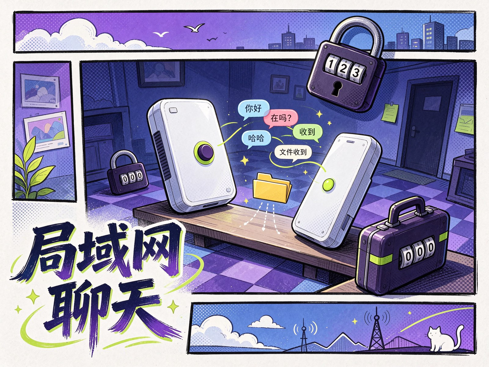

<p align="center"></p>

<p align="center">
  
  
  
</p>

<h1 align="center">💬 internal-chat</h1>

<p align="center">
  <b>局域网 P2P 聊天和文件传输工具</b>
</p>

<p align="center">
  WebRTC 点对点传输 · 无需登录 · 拖拽发文件 · 房间密码保护 · 跨平台
</p>

---

## 📌 项目简介

internal-chat（发个东西）是一款基于 WebRTC 的局域网 P2P 文字聊天和文件传输工具。仅在线用户列表和信令交换需要轻量化服务端，所有数据传输均采用 WebRTC 点对点直连，不经过中间服务器，局域网内互传文字和文件速度快、隐私安全。

> 无需安装任何软件，打开浏览器，直接传输。

---

## ✨ 核心特性

- 💬 **P2P 文字聊天** — 基于 WebRTC DataChannel 的点对点即时通讯
- 📁 **P2P 文件传输** — 拖拽即可发送文件，支持进度显示和速度统计
- 🔒 **房间密码保护** — 支持创建加密房间，MD5 密码验证
- 👤 **自定义昵称** — 设置昵称并持久化到 Cookie，跨会话保持
- 🌐 **零安装** — 打开浏览器即可使用，无需安装客户端
- ⚡ **局域网极速** — 数据直连传输，不走服务器，速度取决于局域网带宽
- 🔄 **自动重连** — 连接断开后自动尝试重新建立 WebRTC 连接
- 📦 **分块传输** — 8KB 分块 + 缺失重传机制，确保文件完整性
- 📱 **移动端适配** — 响应式设计，手机端也可使用
- 🔗 **URL 链接识别** — 自动识别聊天中的 URL 并转为可点击链接
- 📋 **消息复制** — 一键复制聊天消息内容

---

## 🛠️ 技术栈

| 技术 | 用途 |
|------|------|
| **WebRTC** | P2P 数据通道，点对点聊天和文件传输 |
| **WebSocket (ws)** | 信令服务器，仅用于连接建立 |
| **Node.js** | 服务端运行环境 |
| **HTML5 / CSS3 / JavaScript** | 前端界面 |
| **STUN/TURN** | NAT 穿透，支持自定义 TURN 服务器 |

---

## 🚀 快速开始

### 前置条件

- Node.js 16+
- Nginx（可选，用于 HTTPS 和反向代理）

### 安装步骤

```bash
git clone https://github.com/aiyangdie/internal-chat.git
cd internal-chat
```

### 服务端部署

```bash
cd server
npm install
npm run start [port]
```

默认监听 `8081` 端口，可通过参数指定：`npm run start 8082`

### 前端部署

1. 修改 `www/index.js` 第一行 `wsUrl` 变量为你的信令服务器地址
2. 将 `www` 目录用 Nginx 部署为静态网站

### 运行命令

```bash
cd server
npm install
npm start
```

访问 `http://your.domain.com/` 即可使用。

---

## 📂 项目结构

```
internal-chat/
├── server/                  # 信令服务器
│   ├── index.js             # WebSocket 信令服务主入口
│   ├── data.js              # 用户管理（注册/注销/房间/昵称）
│   ├── .room_pwd.json       # 房间密码配置
│   ├── package.json         # 服务端依赖
│   └── package-lock.json
├── www/                     # 前端静态文件
│   ├── index.html           # 主页面
│   ├── index.js             # 前端逻辑（WebSocket/消息/文件发送）
│   ├── xchatuser.js         # WebRTC 封装（XChatUser 类）
│   └── style.css            # 界面样式
├── nginxvhost.conf          # Nginx 反向代理配置参考
├── CNAME                    # 自定义域名
├── LICENSE                  # MIT 开源协议
└── README.md
```

---

## 🤝 贡献与许可证

欢迎贡献！请遵循以下流程：

1. **Fork** 本仓库
2. 创建特性分支: `git checkout -b feature/amazing-feature`
3. 提交更改: `git commit -m 'feat: add amazing feature'`
4. 推送分支: `git push origin feature/amazing-feature`
5. 提交 **Pull Request**

本项目基于 **MIT License** 开源协议。详见 [LICENSE](LICENSE)。

---

## ⚠️ 免责声明

本项目仅用于学习交流，请勿用于非法用途，否则后果自负。
